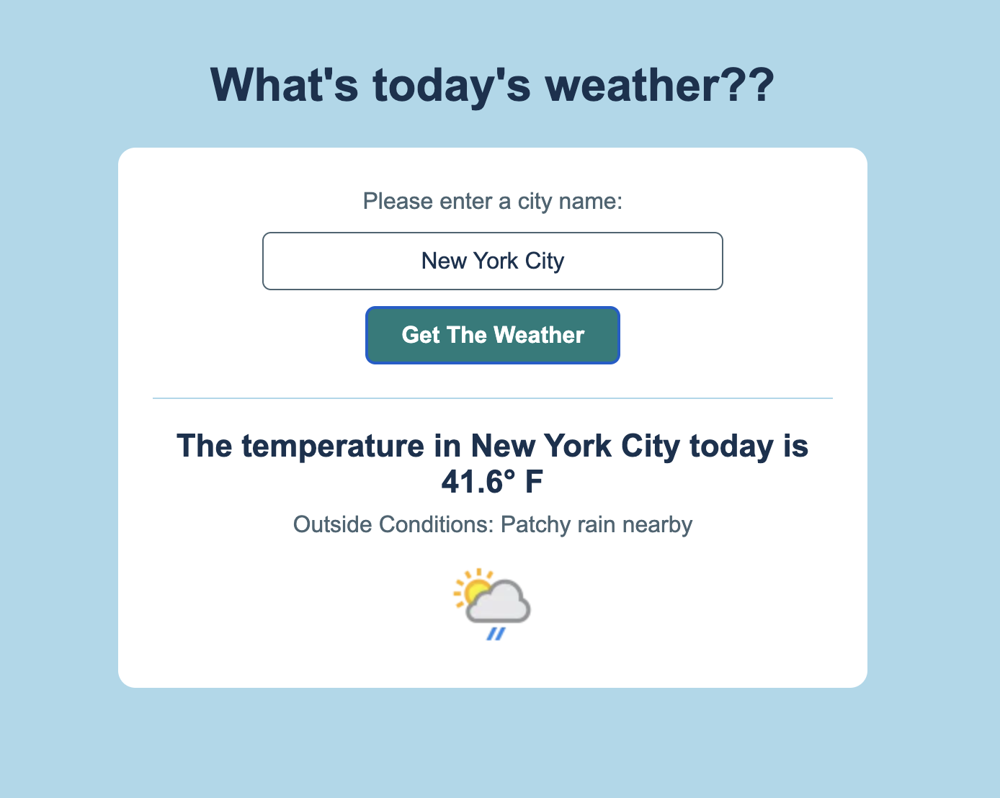

# Weather API

Enter a city and get today's temperature in Fahrenheit.



## What it does

- Takes a city name and fetches its forecast from WeatherAPI.
- Shows today's average temperature in Fahrenheit, the outside conditions, and the condition icon.

## Tech stack

- HTML, CSS, JavaScript (no build step, no server)
- WeatherAPI — forecast for the entered city

## How to run it

Open `weather_api/index.html` in a browser, type a city, and click **Get The Weather**. The API key lives in `weather_api/js/config.js`.

## Project structure

```
weather_api/
  index.html      - city input, button, and the temperature / conditions / icon it fills in
  css/style.css   - page styling
  js/main.js      - the fetch to WeatherAPI and rendering the result
  js/config.js    - API key
```

---

Thay Brown — thaybrown22@gmail.com · https://thaythecoder.netlify.app · https://github.com/tbrown320 · https://www.linkedin.com/in/thaybrown
